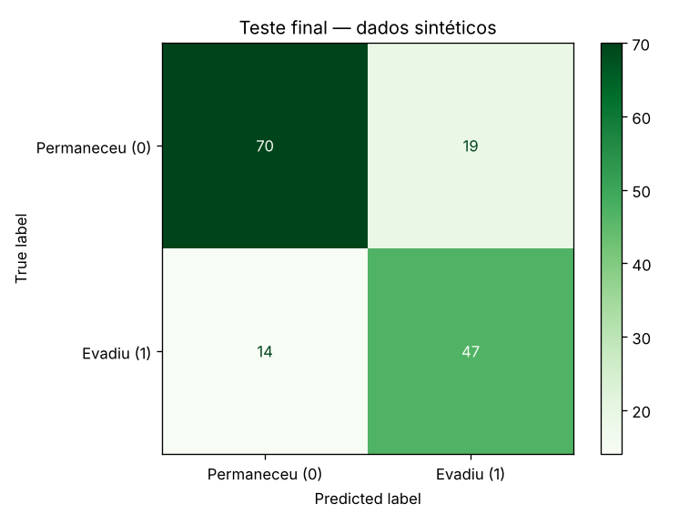
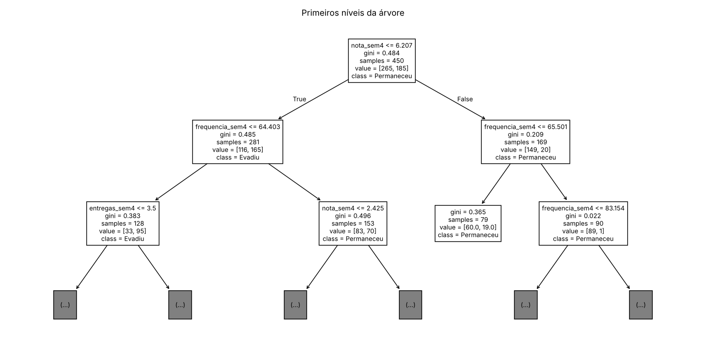
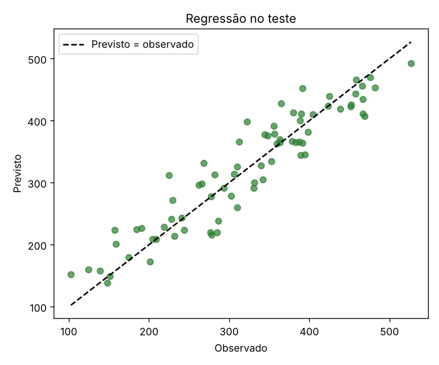
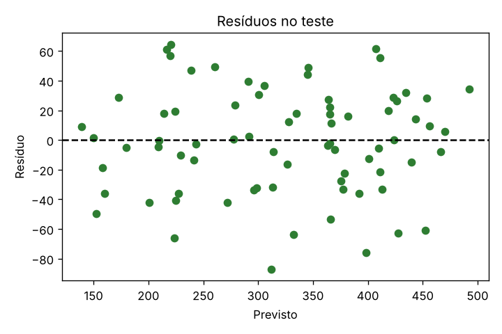

**Profa. Kadidja Valéria | UDF**  
Ciência de Dados e Aprendizado de Máquina · Sistemas de Informação · 2026.2

# Aula 2 — Registro do laboratório supervisionado

## Identificação

- Estudante ou equipe: **Gustavo Carvalho de Oliveira (atividade individual)**
- Instituição e turma: **UDF – Centro Universitário · Sistemas de Informação · Turma: PREENCHER**
- Data de realização: **16/10/2026**
- Integrantes e contribuições (se em equipe): **Não se aplica — atividade realizada individualmente; todas as etapas são de Gustavo Carvalho de Oliveira.**

## Percurso escolhido

- [x] Python/Colab ou Jupyter.
- [ ] Orange Data Mining.

Use o [notebook de apoio](notebooks/laboratorio.ipynb) ou o [CSV sintético](dados/educacionais-sinteticos.csv). O CSV contém 600 registros fictícios. Atributos: `frequencia_sem4`, `nota_sem4`, `entregas_sem4`. Alvo: `evasao_fim_semestre` (0 permaneceu, 1 evadiu). As associações foram definidas pela simulação, sem validade empírica sobre estudantes reais.

## 1. Ambiente e reprodução

| Item | Registro |
| --- | --- |
| Ambiente e data | Jupyter (kernel Python 3), Linux, 16/10/2026 |
| Versões das ferramentas/bibliotecas | Python 3.12.3; NumPy 2.5.4; pandas 3.0.6; matplotlib 3.11.2; scikit-learn 1.9.1 |
| Semente aleatória | 42 (`SEMENTE = 42` na simulação, na divisão, nas dobras da validação cruzada e na árvore) |
| Caminho do notebook executado ou fluxo Orange | [notebooks/laboratorio-equipe.ipynb](notebooks/laboratorio-equipe.ipynb) (execução individual) e [notebooks/resultados_execucao.json](notebooks/resultados_execucao.json) |
| Origem dos dados e condição sintética | Mesma simulação do notebook didático; o notebook confere que os dados gerados são idênticos ao CSV fornecido (`Igual ao CSV fornecido: True`). Dados 100% sintéticos. |

## 2. Problema e preparação

- Pergunta de negócio: **Com o que se sabe ao fim da semana 4, quais estudantes deveriam estar no topo da lista de contato da equipe de apoio?**
- Unidade de análise e horizonte: **Estudante fictício em um semestre; previsão na semana 4, desfecho observado no fim do semestre.**
- Atributos disponíveis no instante da previsão: **`frequencia_sem4` (% de presença, 35–100), `nota_sem4` (0–10), `entregas_sem4` (0–8 atividades).**
- Variável-alvo e sua natureza: **`evasao_fim_semestre`, binária (0 = permaneceu, 1 = evadiu); 354 permaneceram (59,0%) e 246 evadiram (41,0%).**
- Ausências e outros problemas encontrados: **`nota_sem4` tem 30 valores vazios (5% dos registros); as outras colunas estão completas. O desfecho foi sorteado a partir de uma probabilidade, então estudantes com perfis iguais podem ter desfechos diferentes (ruído irredutível).**
- Tratamentos e conjunto usado para aprendê-los: **`SimpleImputer(strategy='median')` como primeiro passo de um `Pipeline`. A mediana é calculada só com os dados de treino — e, durante a validação cruzada, só com as 4 dobras de treino de cada rodada. A árvore dispensa padronização.**

## 3. Desenvolvimento e teste

- Método de divisão e justificativa: **`train_test_split` com 25% para teste, `stratify=y` e `random_state=42`. Os registros da simulação são independentes entre si, então uma divisão aleatória é válida; a estratificação garante cerca de 41% de evasão nos dois lados.**
- Quantidades de treino e teste: **450 no treino e 150 no teste.**
- Procedimento de validação no treino: **`StratifiedKFold` com 5 dobras, `shuffle=True`, `random_state=42`, aplicado apenas aos 450 registros de treino.**
- Parâmetros da árvore e como foram escolhidos: **Diferente do roteiro base, comparei uma grade com as duas configurações ao mesmo tempo **antes** de abrir o teste: `max_depth` ∈ {2, 3, 5, None} × `min_samples_leaf` ∈ {5, 10, 20, 40} (16 combinações). Regra definida antes de rodar: maior acurácia média de validação; se houver combinações a menos de 0,005 da melhor, escolho a mais simples (menor profundidade e maior folha). Resultado: `max_depth=5`, `min_samples_leaf=40` (validação 0,7289 ± 0,0303). As combinações prof. None/leaf 40 empataram exatamente (a árvore já não passa de 5 níveis com folhas de 40), e prof. 5/leaf 20 ficou em 0,7267.**
- Como o teste ficou fora da seleção: **A grade inteira e a regra de desempate foram executadas só no treino. O pipeline final foi ajustado nos 450 registros e só então aplicado uma única vez aos 150 de teste.**

### Alternativa Orange

Confira o alvo como categórico. Registre as conexões: File/Select Columns → Test & Score (Data), Tree → Test & Score (Learner), Test & Score → Confusion Matrix (Evaluation Results). Data Table permite inspeção. Se usar Preprocess, conecte o preprocessor ao learner para ajustar transformações dentro do treino. Não use apenas `Test on train data` como avaliação final.

**Fluxo e método de avaliação realmente utilizados:** Não se aplica — usei o percurso Python/Jupyter.

Se comparar configurações, use validação no treino e reserve teste independente. Documente em Test & Score as entradas Data e Test Data, quando utilizadas.

## 4. Resultados calculados de classificação

| Modelo | Configuração | Acurácia de treino | Acurácia de validação e dispersão | Acurácia de teste |
| --- | --- | --- | --- | --- |
| Referência | `DummyClassifier(strategy='most_frequent')` — prevê sempre "permaneceu" | 0,5889 | 0,5889 ± 0,0000 | 0,5933 |
| Árvore final | Mediana + `DecisionTreeClassifier(max_depth=5, min_samples_leaf=40, random_state=42)` | 0,7622 (treino completo); 0,7756 (média nas dobras) | 0,7289 ± 0,0303 | 0,7800 |

**Matriz: linhas reais e colunas previstas; classe positiva = 1.** ([imagem](assets/matriz-confusao.png))

| Real / previsto | Permaneceu (0) | Evadiu (1) |
| --- | --- | --- |
| Permaneceu (0) | 70 (TN) | 19 (FP) |
| Evadiu (1) | 14 (FN) | 47 (TP) |

- Acurácia calculada manualmente pela matriz: **(70 + 47) / (70 + 19 + 14 + 47) = 117 / 150 = 0,78.**
- Sensibilidade da classe 1: **47 / (47 + 14) = 47 / 61 ≈ 0,770 (77,0%). Precisão da classe 1, como complemento: 47 / (47 + 19) = 47 / 66 ≈ 0,712.**
- Comparação com referência: **0,780 contra 0,593 (+18,7 pontos). Mais importante: a referência tem sensibilidade zero (nunca aponta evasão), enquanto a árvore encontra 47 dos 61 casos de evasão do teste. A acurácia de teste ficou acima da média de validação (0,729); com 150 registros, essa diferença está dentro da variação esperada (cada acerto vale 0,67 ponto) e não indica que o modelo seja "melhor que o previsto".**
- Consequências dos falsos positivos: **19 estudantes que concluiriam o semestre receberiam um convite de apoio. O custo é tempo da equipe e o risco de a pessoa se sentir rotulada — por isso o convite não pode mencionar "risco de evasão". Cerca de 29% dos sinalizados (19 de 66) seriam falsos alarmes.**
- Consequências dos falsos negativos: **14 estudantes que evadiram não apareceriam na lista. Eles só seriam alcançados se o apoio também estivesse aberto por outros caminhos (autoencaminhamento, indicação de professores).**
- Interpretação do gráfico e da árvore: **A raiz pergunta `nota_sem4 ≤ 6,21`; em seguida, os dois ramos perguntam sobre `frequencia_sem4` (≤ 64,4% à esquerda e ≤ 65,5% à direita). Importâncias: nota 0,70, frequência 0,21, entregas 0,09. Ou seja, na simulação, a combinação nota abaixo de ~6 + frequência abaixo de ~65% concentra a evasão. Com folhas de no mínimo 40 registros, a árvore tem poucas regras, todas apoiadas em grupos grandes, o que a torna mais fácil de explicar para a equipe. É uma associação que a própria fórmula da simulação criou, não uma causa ([árvore](assets/arvore.png)).**

## 5. Experimentos no treino

Compare parâmetros usando apenas treino/validação. Após conhecer o teste, uma nova seleção exige novo teste independente para avaliação final.

Como `min_samples_leaf` já entrou na seleção antes do teste (seção 3), os experimentos abaixo investigam outras perguntas. Todos usam validação cruzada de 5 dobras no treino; nenhuma alteração foi adotada.

| Experimento | Alteração | Resultado de validação | Interpretação |
| --- | --- | --- | --- |
| 1 | `class_weight='balanced'` na árvore escolhida (prof. 5, leaf 40) | Padrão: acurácia 0,7289 ± 0,030; sensibilidade 0,605 ± 0,130; precisão 0,700. Balanceada: acurácia 0,7133 ± 0,031; sensibilidade 0,692 ± 0,099; precisão 0,642. | Dar mais peso à classe "evadiu" troca um pouco de acurácia e de precisão por mais sensibilidade (+8,7 pontos). Como o falso negativo é o erro mais grave aqui, essa troca pode valer a pena se a equipe tiver capacidade para mais contatos. A dispersão da sensibilidade é alta (~0,10–0,13), então a vantagem precisaria ser confirmada em um novo teste independente antes de ser adotada. |
| 2 | Treinar com **um único atributo** por vez | Só nota: 0,6756 ± 0,027; só frequência: 0,5956 ± 0,033; só entregas: 0,5867 ± 0,054. Com os três: 0,7289. Referência: 0,5889. | Sozinhas, frequência e entregas praticamente não superam a referência, mas, junto com a nota, melhoram o modelo (de 0,676 para 0,729). Isso mostra que o valor preditivo de um atributo depende dos outros: a frequência ajuda a separar os estudantes **dentro** dos grupos de nota. Continua sendo utilidade para prever, não causa. |

Responda:

1. Como a profundidade e o tamanho das folhas podem afetar o sobreajuste? **A grade da seção 3 mostra isso: com folha 5 e sem limite de profundidade, o treino chega a 0,868 e a validação cai para 0,713 — a árvore cria folhas para pequenos grupos que são só ruído. Aumentando a folha para 40, o treino cai para 0,776 e a validação sobe para 0,729: menos decoreba, mais generalização. No outro extremo, profundidade 2 fica em 0,733 no treino e 0,684 na validação: o modelo é simples demais e não captura a interação nota × frequência (subajuste).**
2. Retirar um atributo e observar mudança no desempenho prova causalidade? **Não. O experimento 2 mostra que "entregas" sozinha quase não ajuda e, ainda assim, poderia ter relação real com o desfecho — ou ser só reflexo de outra coisa (trabalhar, por exemplo, reduz entregas e também aumenta a evasão). Mexer nos atributos do modelo mede quanto cada um ajuda a prever neste conjunto, não o que aconteceria se mudássemos aquele fator na vida do estudante.**
3. Se 95% permanecem, o que acontece com um modelo que sempre prevê permanência? **Acerta 95% e é inútil para o objetivo: em 100 estudantes, os 5 que evadem ficariam todos na coluna "previsto: permaneceu" (FN = 5, TP = 0), e a sensibilidade seria 0. A acurácia alta viria apenas do desbalanceamento, o que mostra por que é preciso olhar a matriz e a sensibilidade.**

## 6. Regressão — seção independente

Execute a seção da biblioteca no notebook ou registre o procedimento equivalente em Orange. Dados também sintéticos. Alvo numérico: empréstimos por semana.

| Item | Registro |
| --- | --- |
| Atributos e alvo | `usuarios_ativos` (100–1000) e `horas_abertura` (20–60 h); alvo `emprestimos_semana`. 300 semanas sintéticas. |
| Divisão e preparação | Holdout aleatório 75/25 (225/75), semente 42; pipeline mediana + `LinearRegression`. Modelo aprendido: empréstimos ≈ 37,3 + 0,348 × usuários + 2,297 × horas. Para conferir o papel de cada atributo, fiz validação cruzada (KFold 5) no treino: MAE com os dois = 28,89 ± 1,77; só usuários = 35,90 ± 3,19; só horas = 83,73 ± 5,36 (quase igual a prever a média). |
| MAE do modelo e unidade | 28,59 empréstimos por semana |
| MAE da referência | 84,73 empréstimos por semana (`DummyRegressor`, média do treino) |
| R² do teste | 0,8774 |
| Interpretação do gráfico observado/previsto | Os pontos seguem a linha tracejada de ponta a ponta, sem curva nem "leque" ([imagem](assets/regressao-observado-previsto.png)). Dos cinco primeiros registros do teste, três erram menos de 4 empréstimos e dois erram 36 e 42 — o MAE de ~29 é uma média de erros pequenos e alguns grandes. |
| Interpretação dos resíduos | Média −1,28, desvio 35,5, de −87,2 a +64,6, espalhados ao redor de zero sem padrão ao longo do eixo previsto ([imagem](assets/regressao-residuos.png)). O desvio dos resíduos é praticamente o ruído colocado na simulação (σ = 35): o que sobra é o que nenhum modelo com esses atributos conseguiria explicar. |
| Limitação de extrapolação | Exemplo calculado: 500 usuários e 40 h → 303 empréstimos, dentro da faixa observada. Já para uma biblioteca com 5.000 usuários, a fórmula daria mais de 1.800, assumindo que cada novo usuário pega livros no mesmo ritmo — algo nunca visto nos dados (acervo e balcão têm limite). Também não há semanas de férias ou provas no conjunto. |

Explique por que R² não é porcentagem de acertos: **Na regressão quase nenhuma previsão bate exatamente com o valor real, então "acertar" não é o critério. O R² compara erros: 1 − (soma dos quadrados dos erros do modelo ÷ soma dos quadrados dos erros de chutar sempre a média do conjunto avaliado). R² = 0,877 quer dizer que o modelo eliminou cerca de 88% do erro quadrático que a média deixaria — e não que 88% das semanas foram previstas corretamente. Se o modelo fosse pior que a média, o R² ficaria negativo.**

## 7. Evidências e conclusão

- Link relativo do notebook/fluxo: **[notebooks/laboratorio-equipe.ipynb](notebooks/laboratorio-equipe.ipynb)**
- Links das imagens, se houver: **[assets/matriz-confusao.png](assets/matriz-confusao.png), [assets/arvore.png](assets/arvore.png), [assets/regressao-observado-previsto.png](assets/regressao-observado-previsto.png), [assets/regressao-residuos.png](assets/regressao-residuos.png)**
- Principal aprendizado: **Toda decisão sobre o modelo — inclusive o tamanho mínimo da folha — precisa ser tomada antes de abrir o teste. Se eu tivesse testado leaf 40 só depois, não poderia usar a acurácia de teste como avaliação honesta. E duas árvores com a mesma acurácia (0,78) podem errar de formas diferentes: a minha troca falsos negativos por falsos positivos.**
- Limitações de generalização e vieses possíveis: **Dados sintéticos com associações escolhidas; um único teste de 150 registros; nenhum atributo de grupo (curso, turno, renda) para checar se o erro é igual para todos; em uma aplicação real, o teste deveria ser um semestre posterior.**
- Cuidados com privacidade e uso responsável: **Nada de identificadores no modelo; lista acessível só à equipe de apoio; resultado usado apenas para priorizar convites voluntários, revisados por uma pessoa; descarte das listas ao fim do semestre.**

[Voltar ao início](README.md).
