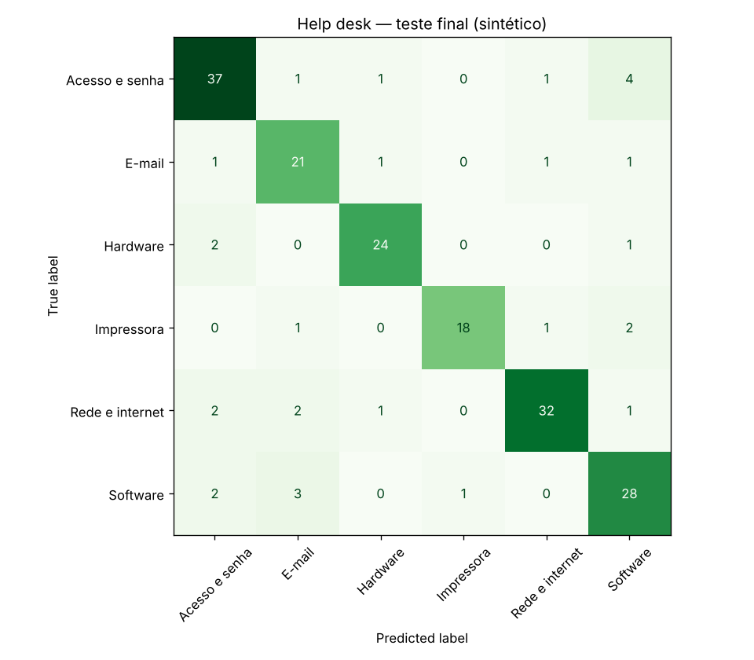

**Profa. Kadidja Valéria | UDF**  
Ciência de Dados e Aprendizado de Máquina · Sistemas de Informação · 2026.2

# Aplicação própria — Triagem de chamados de help desk

## Identificação

- Estudante ou equipe: **Gustavo Carvalho de Oliveira (atividade individual)**
- Instituição e turma: **UDF – Centro Universitário · Sistemas de Informação · Turma: PREENCHER**
- Data de realização: **16/10/2026**
- Integrantes e contribuições (se em equipe): **Não se aplica — atividade realizada individualmente; todas as etapas são de Gustavo Carvalho de Oliveira.**

## 1. O cenário

Escolhi um problema comum em Sistemas de Informação: o **help desk de TI de uma instituição** (cenário fictício). O usuário abre um chamado escrevendo o problema em texto livre, e hoje um atendente lê cada chamado e o envia para uma das filas técnicas. Nos horários de pico, os chamados esperam na triagem antes de chegar a quem resolve, e alguns são enviados para a fila errada e precisam ser repassados.

## 2. Problema escolhido

- **Pergunta de negócio:** é possível sugerir automaticamente a fila de atendimento a partir do texto do chamado, encaminhando direto só os casos em que o modelo está confiante?
- **Decisão apoiada:** encaminhar o chamado para a fila sugerida quando a confiança passa de um limiar; abaixo dele, o chamado continua indo para a triagem humana, como hoje. O técnico da fila pode devolver um chamado errado.
- **Unidade de análise:** um chamado.
- **Atributo:** `texto` escrito pelo usuário, conhecido no momento da abertura.
- **Alvo:** `fila` (6 classes: Acesso e senha, Rede e internet, Software, Hardware, E-mail, Impressora), confirmada depois pelo técnico.
- **Tipo de tarefa:** classificação supervisionada multiclasse de texto.

## 3. Dados

| Item | Registro |
| --- | --- |
| Origem | **Sintética**, gerada no notebook: para cada fila, sorteio de frases típicas ("senha expirada", "vpn não conecta", "papel atolado"...) com complementos ("urgente", "sala 204"). **Nenhum chamado real foi usado.** |
| Tamanho | 760 chamados ([CSV](dados/helpdesk_chamados_sinteticos.csv)), com filas de tamanhos diferentes: Acesso 174, Rede 153, Software 135, Hardware 108, E-mail 101, Impressora 89 |
| Ruído simulado | 12% dos textos substituídos por frases vagas ("não funciona", "ajuda") e 8% das filas trocadas ao acaso, para imitar triagem errada no histórico; alguns chamados juntam dois problemas ("wifi caiu e não consigo logar") |
| Por que não usar dados reais | Chamados reais trazem nomes, salas, e-mails e às vezes senhas digitadas pelo usuário; usar exigiria anonimização, autorização da instituição e política de retenção. |

## 4. Método

| Item | Registro |
| --- | --- |
| Ambiente | Jupyter, Python 3.12.3, scikit-learn 1.9.1, pandas 3.0.6, NumPy 2.5.4. Semente 42. |
| Notebook | [notebooks/helpdesk-chamados.ipynb](notebooks/helpdesk-chamados.ipynb) (executado); resumo em [resultados_helpdesk.json](notebooks/resultados_helpdesk.json) |
| Divisão | Holdout estratificado 75/25: 570 treino, 190 teste |
| Preparação | União de dois TF-IDF **dentro do Pipeline**: palavras (1–2 gramas), que capturam termos como "fila de impressão", e n-gramas de caracteres (2–4), que toleram erros de digitação e falta de acento |
| Modelos comparados | Naive Bayes multinomial (`alpha` 0,1 / 0,5 / 1,0) e regressão logística (`C` 1 / 10) |
| Seleção | Maior **F1 macro** na validação cruzada estratificada de 5 dobras, só no treino. Usei F1 macro porque as filas têm tamanhos diferentes e a fila pequena (Impressora) deve pesar tanto quanto a grande. |
| Limiar de confiança | Também escolhido **no treino**, com probabilidades fora da dobra (`cross_val_predict`). Regra: maior acerto entre os chamados encaminhados. |
| Referência | `DummyClassifier`, sempre a fila mais frequente |

## 5. Resultados calculados

**Validação cruzada (treino):**

| Modelo | Acurácia de treino | Acurácia de validação ± desvio | F1 macro de validação |
| --- | --- | --- | --- |
| Referência (mais frequente) | 0,2281 | 0,2281 ± 0,0000 | 0,0619 |
| Naive Bayes, alpha = 0,1 | 0,8693 | 0,8281 ± 0,0226 | 0,8221 |
| Naive Bayes, alpha = 0,5 | 0,8702 | 0,8316 ± 0,0231 | 0,8269 |
| Naive Bayes, alpha = 1,0 | 0,8697 | 0,8316 ± 0,0231 | 0,8272 |
| **Regressão logística, C = 1 (escolhido)** | 0,8798 | **0,8316 ± 0,0231** | **0,8276** |
| Regressão logística, C = 10 | 0,9053 | 0,8070 ± 0,0229 | 0,7997 |

A regressão logística com C = 1 venceu por 0,0004 de F1 sobre o Naive Bayes com alpha = 1 — um empate na prática, muito menor que o desvio (≈ 0,023). Pela regra definida, fiquei com ela. Já C = 10 mostra sobreajuste: treino maior (0,905) e validação menor (0,807).

**Limiar de confiança (probabilidades fora da dobra, treino):**

| Limiar | Chamados encaminhados direto | Acerto nos encaminhados |
| --- | --- | --- |
| ≥ 0,4 | 89,1% | 0,894 |
| ≥ 0,5 | 80,5% | 0,932 |
| **≥ 0,6 (escolhido)** | 72,6% | **0,935** |
| ≥ 0,7 | 57,2% | 0,929 |

**Teste final (190 chamados, usado uma vez):** acurácia **0,842**, F1 macro **0,844**, contra 0,232 / 0,063 da referência. Com o limiar 0,6, **81,1%** dos chamados seriam encaminhados direto, com **91,6%** de acerto; os outros 18,9% iriam para a triagem humana.

| Fila | Precisão | Sensibilidade (recall) | F1 | Chamados no teste |
| --- | --- | --- | --- | --- |
| Acesso e senha | 0,841 | 0,841 | 0,841 | 44 |
| E-mail | 0,750 | 0,840 | 0,792 | 25 |
| Hardware | 0,889 | 0,889 | 0,889 | 27 |
| Impressora | 0,947 | 0,818 | 0,878 | 22 |
| Rede e internet | 0,914 | 0,842 | 0,877 | 38 |
| Software | 0,757 | 0,824 | 0,789 | 34 |

**Exemplos:** "senha do sistema expirou" → Acesso e senha (0,75); "impressora da sala 204 nao imprime" → Impressora (0,80); "outlook travando" → Software (0,38, abaixo do limiar, vai para triagem — poderia ser E-mail); "nao funciona" → Acesso e senha (0,50, abaixo do limiar: o texto não diz nada); "wifi caiu e nao consigo logar" → Acesso e senha (0,64, encaminhado, mas o problema de fundo provavelmente é de rede).

## 6. Interpretação

- **Resultado calculado:** 84,2% de acerto no teste contra 23,2% da referência, com F1 macro parecido com o da validação (0,844 × 0,828). Usando o limiar, o acerto nos chamados encaminhados sobe para 91,6%.
- **Interpretação:** E-mail e Software são as filas com menor precisão (0,75–0,76): são as que mais recebem chamados de outras filas, porque programas como Outlook e Teams aparecem nas duas. O último exemplo mostra o limite de dar **uma** fila para um chamado com **dois** problemas.
- **Diferença entre treino e teste no limiar:** no teste, 81% passaram do limiar, contra 73% na validação. O modelo final foi treinado com 570 chamados (e não 456, como em cada dobra) e fica mais confiante; o limiar escolhido na validação, portanto, ficou um pouco "folgado" no modelo final. Isso é uma observação, não motivo para trocar o limiar depois de ver o teste.
- **Escolha do limiar:** 0,5 e 0,6 tiveram acerto quase igual na validação (0,932 × 0,935), e 0,5 encaminha mais chamados. Pela regra que defini antes, fiquei com 0,6; trocar para 0,5 seria razoável, mas exigiria um novo teste independente.
- **Hipótese:** em chamados reais, o texto é mais longo e variado e o vocabulário muda quando a instituição adota um sistema novo; espero desempenho menor e necessidade de retreino periódico. Só um teste com chamados de meses posteriores confirmaria isso.
- **Uso proposto:** um erro custa um repasse entre filas (algumas horas de atraso), não um prejuízo grave, desde que o técnico possa devolver o chamado com um clique e esses repasses sejam contados como sinal de que o modelo precisa de revisão.

## 7. Limites, privacidade e próximos passos

- **Dados sintéticos não validam o uso real:** as frases e as filas foram escritas por mim, então o modelo aprendeu o meu vocabulário.
- **Privacidade:** chamados podem conter dados pessoais e até senhas; antes de treinar, seria preciso remover e-mails, matrículas e números de telefone por padrões, manter o modelo no servidor da própria instituição e definir prazo de guarda dos textos.
- **Vieses:** usuários que escrevem pouco ou de forma informal ("pc pifou") tendem a cair abaixo do limiar e esperar mais na triagem; é preciso comparar o tempo de atendimento entre setores antes e depois.
- **Avaliação real:** treinar com meses anteriores e testar nos seguintes; medir a taxa de repasse entre filas e o tempo até o primeiro atendimento, comparando com a triagem manual.
- **Outras aplicações** (ver [atividade 01, seção 5](01-aula1-conceitos.md)): regressão para estimar o tempo de resolução e agrupamento de textos para descobrir problemas recorrentes.

## Fontes

- SCIKIT-LEARN. *User Guide* (Working with text data; Naive Bayes; LogisticRegression; Pipeline e FeatureUnion). https://scikit-learn.org/stable/user_guide.html. Acesso em: 16 out. 2026.
- Material da disciplina (Módulo IV), Profa. Kadidja Valéria, UDF, 2026.
- Uso de IA: assistente de IA (Claude) usado para apoiar a escrita do código e do texto. Executei o notebook e conferi os números.

[Voltar ao início](README.md).
