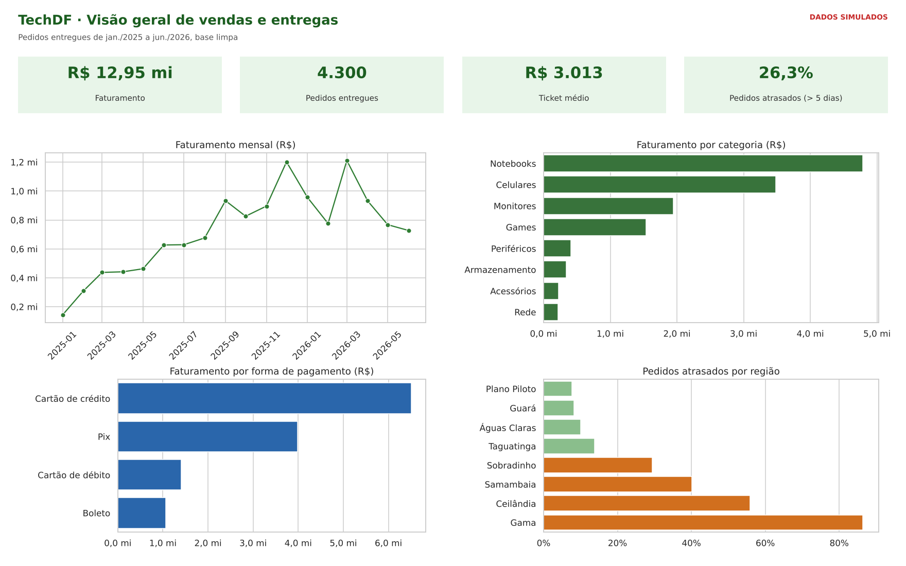
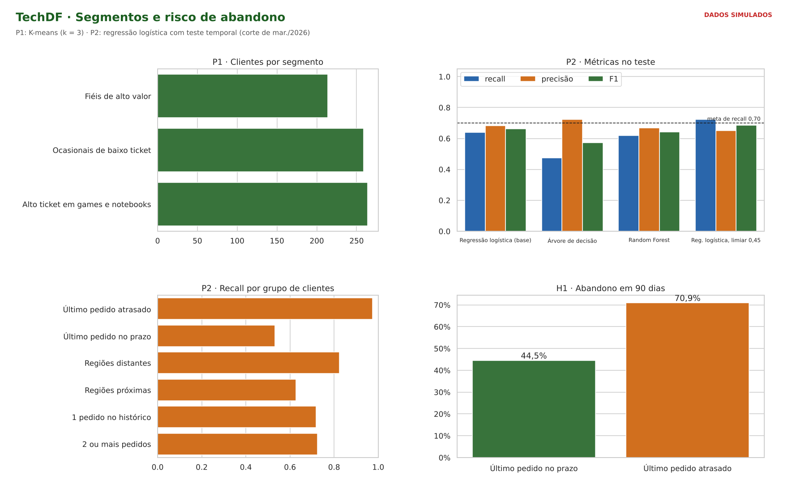
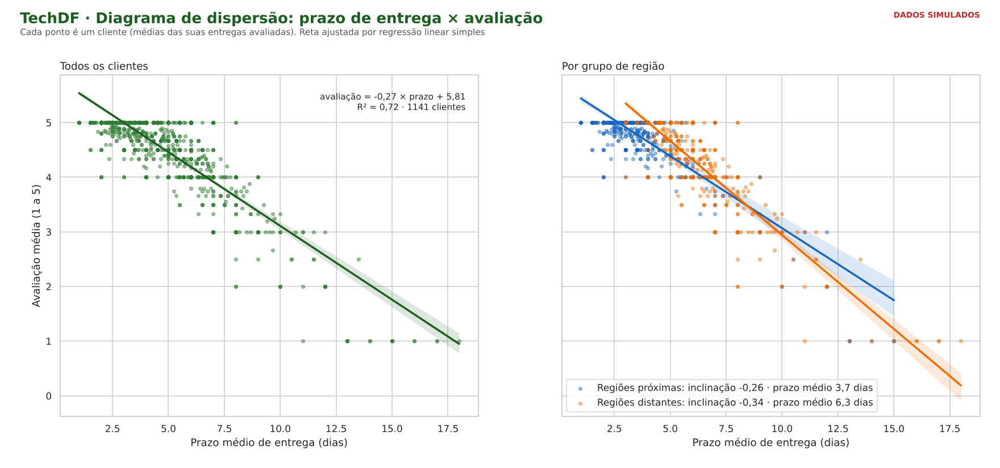

# TechDF – Análise de Dados com CRISP-DM

[](https://colab.research.google.com/github/SEU-USUARIO/TechDF-CRISP-DM-Analysis/blob/main/notebooks/pratica_crispdm_techdf.ipynb)

Parte prática do trabalho de **Ciência de Dados e Aprendizagem de Máquina (A1)**, com a Profa. Kadidja Valéria, no Centro Universitário do Distrito Federal (UDF). Trabalho individual de **Gustavo Carvalho de Oliveira**. O projeto aplica as seis fases do **CRISP-DM** à **TechDF**, loja on-line fictícia de informática que vende para o Distrito Federal. O objetivo é segmentar os clientes para direcionar ações de relacionamento e prever quais deles não voltarão a comprar nos próximos 90 dias.

O repositório reúne uma análise em **SQL** (validações de qualidade e KPIs), um **notebook em Python** com diagrama de dispersão com regressão linear e a modelagem (K-means e classificadores), além de um **dashboard** de três páginas feito em Python (Pandas, Matplotlib e Seaborn) no lugar do Power BI.

> **Dados simulados.** A TechDF é um cenário de estudo. A base foi gerada pelo notebook com a estrutura de um banco relacional de e-commerce (`Cliente`, `Pedido`, `ItemPedido`, `Produto`, `Categoria`, `Regiao`, `FormaPagamento`), com perfis de compra, prazos de entrega por região e erros inseridos de propósito. Os números demonstram o método e **não descrevem uma empresa real**.

## Perguntas de análise

| Pergunta | Técnica | Resposta (dados simulados) |
|---|---|---|
| **P1.** Quais segmentos de clientes existem e que ação oferecer a cada um? | K-means e regras "segmento → ação" | 3 segmentos (Fiéis de alto valor, Alto ticket em games e notebooks, Ocasionais de baixo ticket), silhueta 0,31 |
| **P2.** É possível prever quais clientes ativos não farão nenhum pedido nos próximos 90 dias? | Regressão logística, árvore de decisão e Random Forest, com teste temporal | Sim, com ressalvas: recall 0,72 com limiar escolhido no treino, mas o alerta marca a maioria dos clientes; o atraso na entrega é o sinal mais forte |

## Dados

Base bruta em `dados/`, de jan./2025 a jun./2026, com 30 pedidos datados de jul. a dez./2026 (erro proposital).

| Tabela | Linhas | Conteúdo |
|---|---:|---|
| `pedido` | 4.776 | Cliente, data, forma de pagamento, status, prazo de entrega, avaliação e frete |
| `item_pedido` | 7.956 | Produto, quantidade e preço unitário de cada pedido |
| `cliente` | 1.200 | E-mail fictício, região, data de cadastro e programa de fidelidade |
| `produto` | 34 | Produto, categoria e preço de lista |
| `categoria` | 8 | Notebooks, Celulares, Periféricos, Monitores, Armazenamento, Acessórios, Games e Rede |
| `regiao` | 8 | Plano Piloto, Guará, Águas Claras, Taguatinga, Sobradinho, Samambaia, Ceilândia e Gama |
| `forma_pagamento` | 4 | Cartão de crédito, Pix, boleto e cartão de débito |

Tabelas geradas pelo notebook em `dados/processed/`: `tabela_clientes` (P1), `tabela_risco` (P2, 2.171 linhas cliente × data de corte), `regressao_dispersao`, `perfis_kmeans`, `metricas_modelos`, `desempenho_por_grupo` e `saida_job_mensal` (segmento, ação e alerta de cada cliente).

**Termos usados:**
- **Cliente ativo:** teve ao menos um pedido entregue nos 180 dias anteriores à data de corte.
- **Abandono:** nenhum pedido nos 90 dias seguintes à data de corte (alvo da P2).
- **Atraso:** pedido entregue com mais de 5 dias de prazo.

## Principais resultados

| Resultado | Valor | Fonte |
|---|---|---|
| Pedidos com data futura · duplicados | 30 · 45 (removidos) | SQL V3 e V5 |
| Preços sem vírgula (> 10× o preço de lista) | 142 itens, R$ 20,3 mi inflados (corrigidos) | SQL V4 |
| Faturamento · pedidos entregues · ticket médio | R$ 12,95 mi · 4.300 · R$ 3.012,56 | SQL KPI 1 |
| Pedidos atrasados | 26,3% | SQL KPI 1 |
| Maior categoria | Notebooks (37,0% do faturamento) | SQL KPI 3 |
| Atraso: Plano Piloto × Gama | 7,7% × 86,4% dos pedidos | SQL KPI 5 |
| Avaliação: até 3 dias × 8 dias ou mais | 4,94 × 2,56 | SQL KPI 6 |
| Recompra em 90 dias: 1ª entrega no prazo × atrasada | 64,0% × 46,1% | SQL KPI 7 |
| Regressão linear prazo × avaliação (1.141 clientes) | avaliação = −0,27 × prazo + 5,81 · R² = 0,72 | Notebook, seção 3.1 |
| Segmentos (K-means, k = 3, silhueta 0,31) | Fiéis 214 · Alto ticket 264 · Baixo ticket 259 | Notebook, Fase 4 |
| Modelo final (regressão logística, limiar 0,45) | Recall 0,72 · Precisão 0,65 · F1 0,69 · AUC 0,69 | Notebook, Fase 5 |
| Recall: último pedido atrasado × no prazo | 0,98 × 0,53 | Notebook, Fase 5 |
| Clientes que receberiam alerta em jul./2026 | 508 de 737 | Notebook, Fase 6 |

**Observações:**
- **O preço sem vírgula é o erro mais caro.** Os 142 itens somariam mais que o faturamento real do período. Sem a limpeza da Fase 3, todo indicador de valor ficaria inútil.
- **Três dos quatro critérios técnicos foram atingidos.** Silhueta > 0,25, menor grupo ≥ 5% e recall ≥ 0,70 (depois de reescolher o limiar com validação no treino). O quarto, "candidatos acima do modelo base", não foi: a árvore e o Random Forest tiveram F1 menor que a regressão logística, que ficou como modelo final.
- **O atraso explica boa parte do abandono.** Quem teve a última entrega atrasada abandonou em 70,9% dos casos, contra 44,5% de quem recebeu no prazo. É a "nova pergunta" da avaliação: talvez a melhor ação seja logística (Gama e Ceilândia), e não campanha de marketing.
- **O alerta é amplo demais.** Ele marca cerca de 60% a 69% dos clientes, então a equipe deve priorizar os de maior probabilidade.
- **Fidelidade e frequência andam juntas** (4,99 × 3,22 pedidos por cliente), mas isso é correlação: quem já compra muito tende a entrar no programa.

## SQL

`techdf.sql` (PostgreSQL) contém:
- **Tabelas:** criação das 7 tabelas e comandos `\copy` para carregar os CSVs.
- **V1–V6:** validações de qualidade da base bruta (nulos, quantidade inválida, datas futuras, preço sem vírgula, pedidos duplicados, cancelados com avaliação).
- **Views `pedido_base`, `item_limpo` e `pedido_limpo`:** base limpa (Fase 3).
- **KPI 1–KPI 7:** totais, faturamento por mês, categorias, formas de pagamento, atraso por região, avaliação por prazo e recompra por atraso.
- **Consultas de apoio A e B:** tabela RFM por cliente e frequência por programa de fidelidade.

Para conferir sem instalar o PostgreSQL: `python scripts/rodar_sql_duckdb.py` executa o arquivo inteiro no DuckDB.

`TechDF_Analise_SQL.pdf` (20 páginas) traz uma capa e uma consulta por página, com o SQL colorido e o resultado logo abaixo, gerado por `python scripts/gerar_pdf_consultas.py`.

## Notebook

`notebooks/pratica_crispdm_techdf.ipynb` percorre as seis fases do CRISP-DM:

| Fase | O que o notebook faz |
|---|---|
| 1. Entendimento do negócio | Resume objetivos, metas técnicas, critérios de sucesso e hipóteses |
| 2. Entendimento dos dados | Gera a base, descreve volume e tipos, explora gráficos e verifica a qualidade (V1–V6) |
| 3. Preparação dos dados | Pseudonimiza o e-mail, limpa os erros, traça o diagrama de dispersão prazo × avaliação com regressão linear e constrói as tabelas analíticas |
| 4. Modelagem | K-means (k de 3 a 6) e regressão logística, árvore de decisão e Random Forest, com teste temporal |
| 5. Avaliação | Confronta com os critérios, escolhe o limiar no treino, compara o desempenho por grupo e testa k = 4 |
| 6. Implementação | Protótipo do job mensal (segmento, ação e alerta), monitoramento de drift e dashboard em Seaborn |

O notebook é autossuficiente: gera a própria base e roda direto no Colab pelo botão no topo desta página (**Ambiente de execução → Executar tudo**).

## Dashboard

Feito em Python no lugar do Power BI: **Pandas** agrega os dados, **Seaborn** desenha os gráficos (`barplot`, `lineplot` e `regplot`) e **Matplotlib** monta as páginas. É gerado pelo notebook e salvo em `Dashboard/`.

**Página 1 – Visão geral de vendas e entregas:** indicadores, faturamento mensal, categorias, formas de pagamento e atraso por região.



**Página 2 – Segmentos e risco de abandono:** segmentos do K-means, métricas dos classificadores, recall por grupo e hipótese H1.



**Página 3 – Diagrama de dispersão:** prazo médio de entrega × avaliação média de cada cliente, com reta de regressão linear, para todos e por grupo de região.



## Como executar localmente

```bash
pip install -r requirements.txt
playwright install chromium                                                           # só para gerar os PDFs
jupyter nbconvert --to notebook --execute notebooks/pratica_crispdm_techdf.ipynb      # gera dados/ e Dashboard/
python scripts/rodar_sql_duckdb.py                                                    # validações e KPIs
python scripts/gerar_pdf_consultas.py                                                 # PDF das consultas
```

## Estrutura

```
├── Dashboard/                      páginas do dashboard (PNG), geradas pelo notebook
├── dados/                          base simulada (CSV)
│   └── processed/                  tabelas geradas pelo notebook
├── notebooks/                      notebook CRISP-DM (abre no Colab)
├── relatorio/                      fonte HTML e figuras do relatório
├── scripts/                        SQL no DuckDB e PDF das consultas
├── techdf.sql                      validações, views da base limpa, KPIs e consultas de apoio
├── TechDF_Analise_SQL.pdf          consultas com os resultados
├── Trabalho_CRISP-DM_TechDF.pdf    relatório do trabalho (6 fases + parte prática)
├── requirements.txt
└── README.md
```

## Ferramentas

- PostgreSQL / DuckDB (SQL)
- Pandas e NumPy (preparação dos dados)
- Matplotlib e Seaborn (visualização e dashboard, no lugar do Power BI)
- scikit-learn (K-means, regressão linear e classificadores)
- Playwright e Pygments (PDF das consultas)
- Jupyter / Google Colab

## Autor

Gustavo Carvalho de Oliveira – Perguntas 1 e 2 (trabalho individual)

## Sobre

Cenário de estudo: TechDF, loja on-line fictícia de informática no DF, continuação da análise exploratória feita na Unidade II da disciplina. Metodologia: CRISP-DM (Chapman et al., 2000), seguindo o guia da disciplina.

`crisp-dm` `data-science` `machine-learning` `sql` `postgresql` `python` `scikit-learn` `k-means` `e-commerce` `churn`
