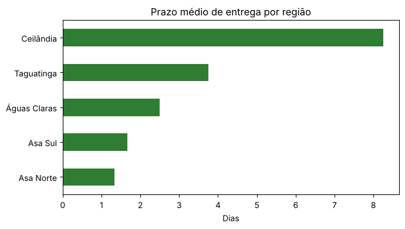
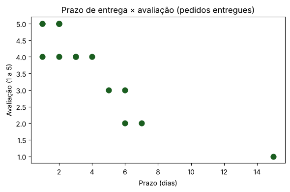
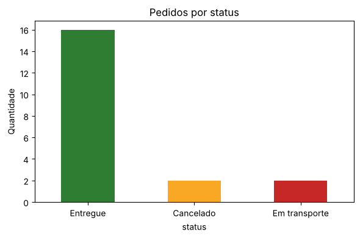
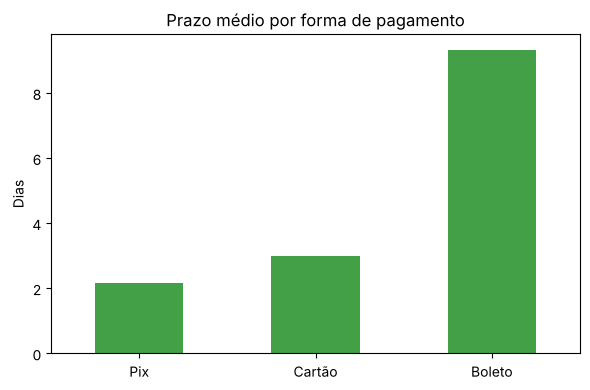

# Unidade II — Análise e Ciência de Dados

**Gustavo Carvalho de Oliveira** · UDF – Centro Universitário · Sistemas de Informação  
**Professora:** Kadidja Valéria · Aula de 02/09/2026

Visualização e interpretação de dados: aula prática, criação de gráficos e interpretação das informações obtidas.

## Arquivos

| Arquivo | Conteúdo |
| --- | --- |
| [Capitulo2_python.ipynb](Capitulo2_python.ipynb) | Pandas básico com o estoque de uma loja de informática: inspeção, tipos de dados, criar/remover colunas, agregações, salvar e ler CSV |
| [Ciencia_Dados.ipynb](Ciencia_Dados.ipynb) | Análise dos pedidos de uma loja on-line no DF: seleção, filtros, conversão de tipos, agrupamentos e 4 gráficos comentados |
| [pedidos_loja_online.csv](pedidos_loja_online.csv) | Base usada na análise (20 pedidos fictícios, agosto de 2026); o notebook também a recria sozinho |

**Todos os dados são fictícios**, criados para a atividade.

## Pergunta norteadora

Onde estão os atrasos de entrega e o que eles têm a ver com a satisfação do cliente?

## Visão geral da base

20 pedidos e 8 colunas. 16 foram entregues, 2 cancelados e 2 estão em transporte. Prazo e avaliação só existem para os entregues (16 valores), então as ausências são esperadas. Prazo médio de 3,9 dias, mas mediana de 2,5 dias: um único pedido de 15 dias puxa a média para cima.

## Visualizações comentadas

### 1. Prazo médio por região

Ceilândia tem prazo médio de 8,25 dias, mais que o dobro de Taguatinga (3,75) e cerca de seis vezes o da Asa Norte (1,33). Mesmo retirando o pedido de 15 dias, a média de Ceilândia fica em 6 dias, ainda bem acima das demais.

### 2. Prazo × avaliação

A correlação entre prazo e nota é −0,89: entregas mais longas tiveram notas mais baixas, e todas as notas 1 e 2 aparecem em entregas de 6 dias ou mais. É uma associação em 16 pedidos, não prova de causa.

### 3. Pedidos por status

80% dos pedidos foram entregues. Os dois em transporte são do fim do mês, então ainda não podem ser contados como atraso.

### 4. Prazo médio por forma de pagamento

Boleto: 9,33 dias e nota média 2,0; Pix: 2,17 dias e nota 4,5. O efeito está misturado com o da região, porque 2 dos 3 boletos entregues são de Ceilândia. Seriam necessários mais pedidos e a data de pagamento para separar as duas coisas.

## Conclusões

1. O principal ponto de atenção é a entrega em **Ceilândia**: vale investigar a transportadora e a rota.
2. **Prazo e satisfação andam juntos**, então reduzir atrasos é o caminho mais provável para melhorar as avaliações.
3. A diferença do **boleto** pode ser real (tempo de compensação) ou só reflexo da região; com estes dados não dá para separar.
4. **Limites:** são só 20 pedidos de um mês, e cada região tem de 2 a 4 entregas. Um único pedido muda bastante as médias, então as conclusões são hipóteses a verificar com mais dados.

## Referência

CARVALHO, André Carlos de; MENEZES, Angelo; BONIDIA, Robson. *Ciência de Dados — Fundamentos e Aplicações*. Capítulo “Python para Ciência de Dados”. Disponível em: https://bonidia.github.io/cd-fundamentos/cp2.html. Acesso em: 2 set. 2026.

Uso de IA: assistente de IA (Claude) usado para apoiar a escrita do código e dos comentários. Executei os notebooks e conferi os números.
